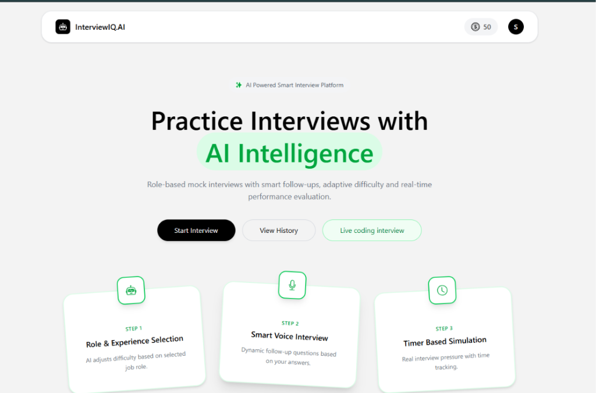
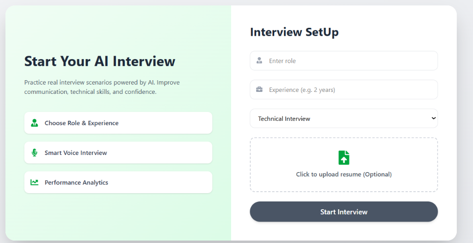
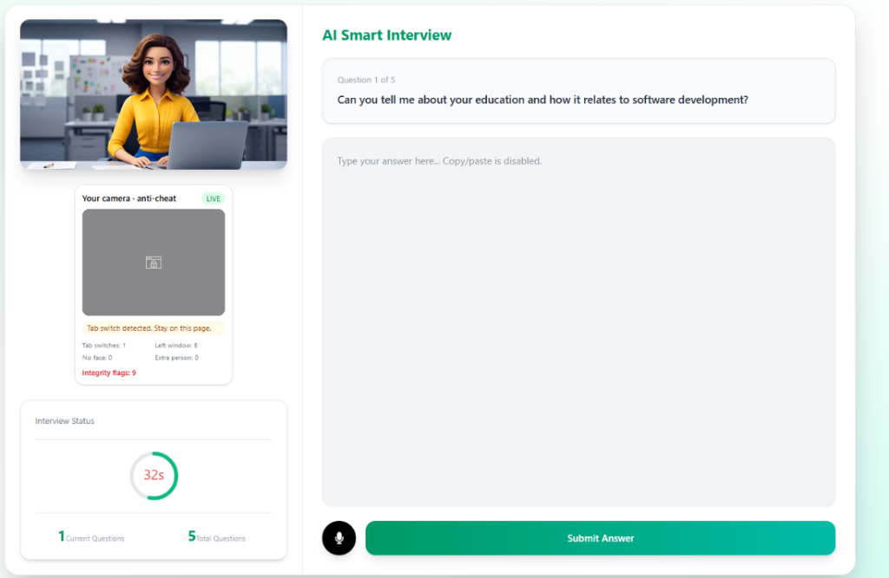
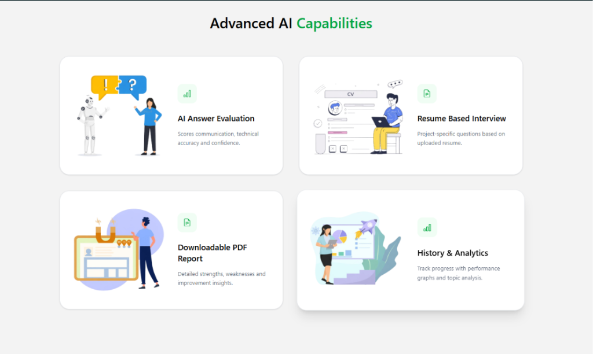
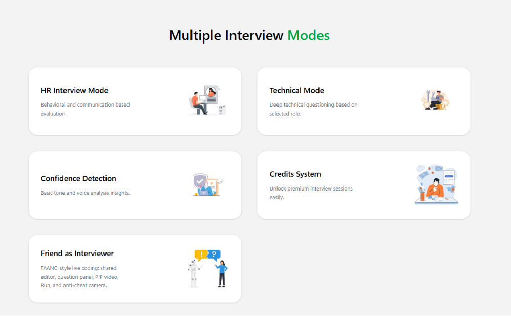
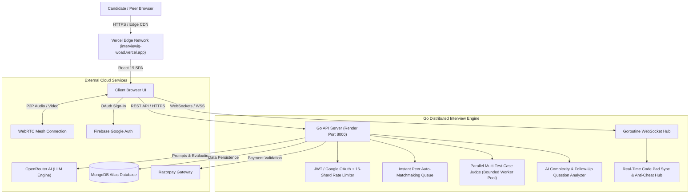

<div align="center">

# ⚡ InterviewIQ.AI

### **Production-Grade AI Mock Interview & Real-Time Peer Collaborative Coding Platform**

[](https://interviewiq-woad.vercel.app)
[](https://interviewiq-tb6d.onrender.com/health)
[](https://react.dev/)
[](https://tailwindcss.com/)
[](https://www.mongodb.com/atlas)
[](https://www.docker.com/)
[](LICENSE)

<br/>

### **[🌐 Launch Live Application (Vercel Edge CDN)](https://interviewiq-woad.vercel.app)**
*⚡ Instant 0.1s load time • Zero cold start • Globally distributed on Vercel Edge Network*

<br/>

**[📸 Product Showcase](#-product-showcase)** • **[⚡ FAANG Code Judge & Matchmaking](#-distributed-interview--code-judge-engine-faang-highlights)** • **[🚀 Key Capabilities](#-key-capabilities)** • **[🏛 System Architecture](#-system-architecture)** • **[⚡ Quick Start](#-quick-start)** • **[📡 API Specs](#-api--websocket-reference)**

<br/>

<a href="https://interviewiq-woad.vercel.app">
  
</a>

<br/>

**InterviewIQ** is an end-to-end, FAANG-caliber interview readiness platform. It pairs intelligent, dynamic LLM-driven mock interviews with live anti-cheat camera proctoring, multi-modal answer inputs (speech-to-text / text), real-time peer collaborative coding with WebRTC video, and comprehensive performance scorecards.

</div>

---

## 📸 Product Showcase

<div align="center">

### 1. 🎯 Personalized Interview Setup & Resume Context
*Customize target job role, experience level, and interview focus. Upload PDF resumes for automatic background and stack extraction.*



<br/><br/>

### 2. 🤖 Live AI Mock Interview Studio with Real-Time Proctoring
*Interactive AI interviewer avatar, live speech-to-text voice answer recording, per-question countdown timers, and in-browser camera anti-cheat integrity tracking (detecting tab switches, face presence, and window blur).*



<br/><br/>

### 3. ⚡ Advanced AI Capabilities
*Dynamic question progression, multi-factor evaluation (Correctness, Technical Communication, Confidence), automated PDF scorecards, and historical progress tracking.*



<br/><br/>

### 4. 🔥 Versatile Interview Modes
*From Technical Deep-Dives to HR Behavioral evaluation, Tone & Confidence detection, and Peer Collaborative Coding rooms.*



</div>

---

## 🌐 Distributed Interview & Code Judge Engine (FAANG Highlights)

InterviewIQ powers its Live Coding & AI Mock Interviews with a high-concurrency Go execution engine:

| Feature / Subsystem | How It Works in InterviewIQ | Why It Stands Out |
|---|---|---|
| **1. Parallel Multi-Test-Case Code Judge** | Executes candidate solutions against sample & hidden test cases concurrently across a bounded Go worker pool (`POST /api/peer/{code}/judge`) | Delivers LeetCode/HackerRank-style **`Accepted` / `Wrong Answer` verdicts** with per-test-case execution time (`ms`) |
| **2. AI Live Code Complexity & Follow-Up Copilot** | Analyzes the candidate's live code in real time (`POST /api/peer/{code}/analyze`) for **Big-O Time & Space Complexity**, edge cases, and code quality score (`0–10`) | Gives the interviewer instant, context-aware follow-up questions tailored to the candidate's exact implementation |
| **3. Instant Peer Auto-Matchmaking Queue** | Atomic MongoDB matchmaking queue (`POST /api/peer/matchmake`) that pairs waiting candidates and interviewers into a live WebRTC + WebSocket coding room | Works just like Pramp / interviewing.io — 1-click pairing or private invite link |
| **4. Built-In FAANG DSA Problem Bank** | One-click problem selector inside the live coding pad (*Two Sum*, *Maximum Subarray (Kadane's)*, *Valid Parentheses*, etc.) with starter templates in **JS, Python, Java, and C++** | Eliminates manual copy-pasting during technical mock interviews |
| **5. Fault-Tolerant Sandbox & Circuit Breakers** | Semaphore-bounded worker pool (`4` workers, `64` queue depth), 3-state circuit breakers, and 16-shard token-bucket rate limiting (`server-go/internal/distributed/engine.go`) | Isolates heavy code execution from starving real-time WebSocket signaling & WebRTC negotiation |

---

## 🚀 Key Capabilities

### 🤖 1. AI Mock Interview Simulator
- **Resume-Driven Context**: Upload PDF resumes to automatically extract technical background, project history, and tech stack proficiencies.
- **Dynamic Question Generation**: Generates customized behavioral, system design, and data structure/algorithm questions matching target seniority levels.
- **Multi-Modal Answer Submission**: Real-time voice speech-to-text recording or manual text input with dynamic countdown timers.
- **Granular AI Scoring & Feedback**: Instant category-wise scoring across Problem Solving, Technical Communication, Code Quality, and Behavioral Fit.
- **Comprehensive PDF Reports**: Export high-resolution graphical interview performance dossiers with radar charts via `jsPDF`.

### 👥 2. Real-Time Collaborative Peer Coding Rooms (CoderPad + LeetCode Judge)
- **Instant Peer Auto-Matchmaking**: 1-click **"⚡ Instant Auto-Match"** queue pairs waiting candidates and interviewers into a live coding session automatically (or share a private room invite link).
- **Built-In FAANG DSA Problem Bank**: Switch between curated FAANG coding problems (*Two Sum*, *Maximum Subarray / Kadane's*, *Valid Parentheses*, etc.) with starter templates in **JavaScript**, **Python**, **Java**, and **C++**.
- **Parallel Multi-Test-Case Code Judge**: Executes candidate code against sample and hidden test cases concurrently in a bounded Go worker pool, returning **`✅ Accepted` / `❌ Wrong Answer`** verdicts and per-case execution latency (`ms`).
- **AI Live Code Complexity Copilot**: 1-click **"✨ AI Complexity Check"** evaluates Big-O Time & Space complexity, code quality (`0–10`), and suggests follow-up questions for the interviewer.
- **Bidirectional WebSocket Sync & WebRTC Video**: Sub-5ms synchronized typing, live test-case verdict broadcasting, P2P audio/video calling, and real-time anti-cheat tab-switch alerts.

### ⚡ 3. Ultra-Fast Go Backend Architecture
- **Sub-Millisecond Response Times**: Native Go standard library HTTP routing with lightweight concurrency primitives (`goroutines` + channels).
- **Hardened Authentication**: Stateless JWT session tokens securely delivered via `HttpOnly`, `SameSite=None`, and SSL-enforced cookies for seamless cross-origin support.
- **Resilient MongoDB Driver**: Auto-reconnecting connection pool with non-blocking graceful fallback.

### 💳 4. Flexible Credits & Monetization
- **Tier-Based Credit System**: Basic and Pro interview preparation bundles.
- **Razorpay Checkout Integration**: End-to-end automated payment ordering, client SDK integration, and cryptographically verified HMAC-SHA256 webhooks.

### 📦 5. High-Performance Hybrid Cloud Architecture
- **Frontend on Vercel**: Hosted globally on Vercel Edge CDN for instant sub-second rendering, zero cold starts, and seamless client routing.
- **Backend on Render / Docker**: High-throughput Go API engine with WebSockets, sandbox runners, and MongoDB Atlas persistence.

---

## 🏛 System Architecture



---

## 🛠 Tech Stack

| Domain | Technology | Description |
|---|---|---|
| **Live Frontend** | [Vercel](https://vercel.com) | Edge CDN deployment: **`https://interviewiq-woad.vercel.app`** (0s Cold Start) |
| **Backend API Engine** | [Render](https://render.com) / Go | High-throughput Go REST & WebSocket engine (`https://interviewiq-tb6d.onrender.com`) |
| **Frontend Framework** | React 19 (Vite) | High-speed component rendering, modern hooks, zero-lag UI |
| **Styling** | TailwindCSS v4 | Modern responsive glassmorphism and theme engine |
| **State Management** | Redux Toolkit | Predictable centralized application state |
| **Real-Time Gateway** | WebSockets (Gorilla/Native) | Bidirectional room broadcast and peer synchronization |
| **Backend API** | Go (Golang 1.23+) | High-concurrency, memory-safe compiled backend |
| **Database** | MongoDB 7.0 / Atlas | Document store for users, peer rooms, reports, and payments |
| **AI Engine** | OpenRouter (LLMs) | Dynamic question synthesis and multi-factor evaluation |
| **Authentication** | Firebase Auth + JWT | Google OAuth + HttpOnly secure cookie sessions |
| **Payments** | Razorpay API | Secure payment checkout and cryptographic verification |
| **Containerization** | Docker & Docker Compose | Multi-stage, minimal footprint Alpine Linux runtime |

---

## 📁 Repository Structure

```text
├── docs/screenshots/           # High-resolution production application previews
├── client/                     # React 19 Frontend SPA (Vite + TailwindCSS v4)
│   ├── src/
│   │   ├── components/         # Reusable UI elements (Navbar, Modals, Editor, Timer)
│   │   ├── hooks/              # Custom hooks (useRoomSocket, WebRTC handlers, useProctoring)
│   │   ├── pages/              # Primary application routes
│   │   │   ├── Home.jsx        # Landing page & feature showcase
│   │   │   ├── Auth.jsx        # Google sign-in & onboarding
│   │   │   ├── InterviewPage.jsx # AI mock interview studio
│   │   │   ├── InterviewReport.jsx # Analytical score reports & PDF export
│   │   │   ├── PeerInterviews.jsx  # Collaborative lobby & room generation
│   │   │   ├── PeerRoom.jsx    # Split-screen editor, video, and code runner
│   │   │   └── Pricing.jsx     # Subscription & interview credit plans
│   │   └── utils/              # Firebase configuration, API clients, helpers
│   ├── package.json
│   ├── vercel.json             # Vercel SPA rewrite configuration
│   └── vite.config.js
│
├── server-go/                  # High-Performance Go Backend Engine
│   ├── internal/
│   │   ├── auth/               # JWT creation, cookie dispatch, token parsing
│   │   ├── config/             # Environment configuration loader
│   │   ├── db/                 # Resilient MongoDB Atlas connection & auto-retry pool
│   │   ├── distributed/        # Bounded sandbox worker pool, circuit breakers, sharded rate limiter
│   │   ├── handlers/           # HTTP controllers (Auth, AI Interview, Code Judge, Matchmaking, Payment)
│   │   ├── httpx/              # HTTP middleware, CORS, JSON context wrappers
│   │   ├── models/             # Domain entities (User, Interview, Room, Payment)
│   │   ├── realtime/           # Thread-safe WebSocket room hub & broadcasting
│   │   └── services/           # AI extraction, multi-language sandbox runner, Razorpay, PDF parser
│   ├── go.mod
│   ├── go.sum
│   └── main.go                 # Server entrypoint & SPA file server
│
├── Dockerfile                  # Production multi-stage build (Client + Go API)
├── docker-compose.yml          # Local containerized MongoDB service
├── render.yaml                 # One-click Render Blueprint definition
├── vercel.json                 # Root Vercel deployment definition
├── railway.json                # 1-Click Railway deployment configuration
├── start.ps1                   # One-click development bootstrap script
└── README.md
```

---

## ⚡ Quick Start (Local Development)

### Prerequisites
- **Go**: `1.23+` installed ([Download Go](https://go.dev/dl/))
- **Node.js**: `v20+` & `npm` ([Download Node.js](https://nodejs.org/))
- **Docker Desktop** or local **MongoDB**: `7.0+`

---

### Option A: One-Command Bootstrap (Windows PowerShell)

Run the included automated startup script:

```powershell
.\start.ps1
```
*This launches MongoDB in Docker, starts the Go backend on port 8000, and spins up the Vite development server on port 5173.*

---

### Option B: Manual Step-by-Step Setup

#### 1. Clone the Repository
```bash
git clone https://github.com/Shivampal157/interviewiq.git
cd interviewiq
```

#### 2. Start Local MongoDB
```bash
docker compose up -d
```
*(Runs MongoDB mapped to port `27018`).*

#### 3. Configure Backend Environment
Copy the example environment configuration into `server-go/.env`:

```bash
cp server-go/.env.example server-go/.env
```

Edit `server-go/.env`:
```env
PORT=8000
MONGODB_URL=mongodb://127.0.0.1:27018/interviewiq
JWT_SECRET=your-secure-random-jwt-secret-string
CLIENT_URL=http://localhost:5173
OPENROUTER_API_KEY=your-openrouter-api-key
RAZORPAY_KEY_ID=optional-razorpay-key
RAZORPAY_KEY_SECRET=optional-razorpay-secret
```

#### 4. Run the Go API
```bash
cd server-go
go run .
```
Backend will be listening at **`http://localhost:8000`**.

#### 5. Run the React Client
In a separate terminal:
```bash
cd client
npm install
npm run dev
```
Frontend will be running at **`http://localhost:5173`**.

---

## 🌐 Production Deployment

### Frontend (Vercel Edge Network)
The production web frontend is hosted on Vercel:  
👉 **`https://interviewiq-woad.vercel.app`**

### Backend API (Render Docker Container)
The Go backend engine is hosted on Render:  
👉 **`https://interviewiq-tb6d.onrender.com`**

To configure Google Sign-In for your deployment:
1. Open the **[Firebase Console](https://console.firebase.google.com/project/interviewiq-3746a/authentication/settings)**.
2. Under **Authorized domains**, click **Add domain**.
3. Add **`interviewiq-woad.vercel.app`** and click **Save**.

---

## 📡 API & WebSocket Reference

### REST Endpoints

| Method | Endpoint | Description | Auth Required |
|---|---|---|---|
| `POST` | `/api/auth/google` | Verify Google ID token & generate HTTP-only session cookie | ❌ |
| `GET` | `/api/auth/logout` | Clear authenticated session cookies | ❌ |
| `GET` | `/api/user/current-user` | Fetch authenticated user profile & remaining credits | ✅ |
| `POST` | `/api/interview/resume` | Upload & parse candidate resume PDF | ✅ |
| `POST` | `/api/interview/generate-questions`| Generate tailored AI interview questions | ✅ |
| `POST` | `/api/interview/submit-answer` | Submit candidate answer for real-time scoring | ✅ |
| `POST` | `/api/interview/finish` | Finalize interview & generate comprehensive feedback report | ✅ |
| `GET` | `/api/interview/get-interview` | Retrieve candidate interview history | ✅ |
| `GET` | `/api/interview/report/{id}` | Retrieve specific detailed interview scorecard | ✅ |
| `POST` | `/api/peer/create` | Create a synchronized peer interview room | ✅ |
| `POST` | `/api/peer/matchmake` | Auto-match with an online peer in the live interview queue | ✅ |
| `GET` | `/api/peer/{code}` | Retrieve room metadata & active participant status | ✅ |
| `POST` | `/api/peer/{code}/run` | Execute code against bounded sandbox worker pool (JS, Python, Java, C++) | ✅ |
| `POST` | `/api/peer/{code}/judge` | Run parallel multi-test-case code judge (`Accepted` / `Wrong Answer` verdict) | ✅ |
| `POST` | `/api/peer/{code}/analyze` | AI live code review (Big-O Time/Space complexity & follow-up questions) | ✅ |
| `POST` | `/api/payment/order` | Initialize Razorpay payment order for credits | ✅ |
| `POST` | `/api/payment/verify` | Cryptographically verify HMAC payment signature | ✅ |
| `GET` | `/health` | Service health probe & database connection status | ❌ |

### Real-Time WebSocket Protocol (`/ws`)

Clients authenticate and join collaborative rooms over WebSocket with standard payloads:

```json
// Example: Code Synchronization Broadcast
{
  "type": "code-update",
  "room": "ROOM_CODE",
  "payload": {
    "code": "function twoSum(nums, target) { ... }",
    "language": "javascript",
    "cursor": { "line": 12, "ch": 4 }
  }
}
```

```json
// Example: Anti-Cheat Tab-Switch Event
{
  "type": "anti-cheat-alert",
  "room": "ROOM_CODE",
  "payload": {
    "event": "tab_switch_detected",
    "timestamp": 1729601400000
  }
}
```

---

## 🤝 Contributing

Contributions make the open-source community an incredible place to learn, inspire, and create. Any contributions you make are **greatly appreciated**.

1. Fork the Project
2. Create your Feature Branch (`git checkout -b feature/AmazingFeature`)
3. Commit your Changes (`git commit -m 'feat: Add some AmazingFeature'`)
4. Push to the Branch (`git push origin feature/AmazingFeature`)
5. Open a Pull Request

---

## 📄 License

Distributed under the **MIT License**. See `LICENSE` for more information.

---

<div align="center">

Developed with ❤️ by **[Shivam Pal](https://github.com/Shivampal157)**

⭐ If you found this project helpful, please consider giving it a star on [GitHub](https://github.com/Shivampal157/interviewiq)!

</div>
